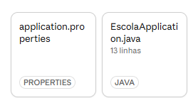

# PROMPTS: Grupo ____

**Integrantes:**

1. João Victor Bondaczuk Sousa 
2. Danilos Ramos Clude
3.

**Prova:** API em MVC

**Usamos IA?** (X) Sim  ( ) Não

**Qual ferramenta e modelo (se usaram):**

1. Claude

> Quem não usou IA: troque "prompt" por "passo". Em cada bloco abaixo, descreva o que vocês fizeram naquele passo, na ordem em que aconteceu, e preencha os outros campos do mesmo jeito.

## Registro, na ordem

Copie o bloco abaixo para cada prompt. Escreva o prompt exatamente como foi enviado.

### Prompt 1

**O prompt (cópia exata):**
```markdown
O que a API precisa fazer

- Cadastrar uma sala, listar todas, buscar uma pelo id e excluir.
- Reservar uma sala e liberar uma sala.
- Responder cada situação com o status HTTP certo: sucesso, criado, sem conteúdo, não encontrado, conflito e dados inválidos.## As regras da escola

- Toda sala cadastrada começa livre.
- O **código é único**: não pode haver duas salas com o mesmo código.
- **Código e nome são obrigatórios**, e a **capacidade precisa ser maior que zero**.
- Uma sala que já está reservada **não pode ser reservada de novo**.
- Só pode ser liberada uma sala que **está reservada**.
- Uma sala reservada **não pode ser excluída**.
- Pedir, reservar, liberar ou excluir uma sala que não existe é um caso de "não encontrado".

## O que o projeto precisa ter

- O projeto **`Escola-base`**, que o professor entrega, e que vocês usam como ponto de partida. Ele já traz Spring Web, Spring Data JPA, validação e banco **H2 em memória**, e já sobe sem nenhuma classe de vocês. Não precisa criar projeto. O arquivo `README.md` dele explica como rodar.
- Organização em camadas, **cada uma no seu pacote, criado por vocês** dentro de `src/main/java/escola`: `model`, `repository`, `service` e `controller`. O projeto base não traz essas pastas prontas.
- As regras da escola ficam na **Service**. O **Controller** só recebe a requisição, chama a Service e devolve a resposta HTTP. O Controller não conversa direto com o Repository.
```

Analise os principais pontos referêntes de necessidade da escola utilize para criar um prompt que resolva de forma integra os problemas
> 

**O que a IA devolveu (uma ou duas linhas):**

O Claude orientou no desenvolvimento da arquitetura das pastas de model, repository controller e expection

**O que fizemos com a resposta:** (*) usamos como veio  ( x ) alteramos  ( ) descartamos

**Por quê (o que conferimos, o que mudamos):**

Criamos a estrutura dentro da pasta escola para criar os arquivos de forma organizada

### Prompt 2

**O prompt (cópia exata):**

```markdown
 Passo | O que fazer | Status esperado |
| --- | --- | --- |
| 1 | Cadastrar a sala de código LAB-01, nome Lab Informatica, capacidade 30 | 201 |
| 2 | Cadastrar outra sala com o mesmo código LAB-01 | 409 |
| 3 | Cadastrar uma sala sem nome | 400 |
| 4 | Reservar a sala 1 | 200 |
| 5 | Reservar a sala 1 de novo | 409 |
| 6 | Excluir a sala 1 (que está reservada) | 409 |
| 7 | Liberar a sala 1 | 200 |
| 8 | Liberar a sala 1 de novo | 409 |
| 9 | Excluir a sala 1 | 204 |
| 10 | Buscar a sala 1 | 404 |
```

Você deve seguir essa orientação das tabelas

> 

**O que a IA devolveu (uma ou duas linhas):**

importou as libs do Jakarta para executar operações no banco

**O que fizemos com a resposta:** ( ) usamos como veio  ( x ) alteramos  ( ) descartamos

**Por quê (o que conferimos, o que mudamos):**

Crud de criar, listar e deletar salas.

(continuem com quantos blocos precisarem)

## Como conferimos

Descrevam como vocês testaram o que ficou pronto. Colem aqui a saída do programa (POO) ou o resultado do roteiro (API) e digam se bateu com a tabela da prova. Se não bateu, digam o que fizeram.

## Onde a IA errou, ou onde nós erramos

Contem pelo menos um erro que apareceu durante a prova: o que era, como perceberam e como resolveram. Se não apareceu nenhum, expliquem como vocês têm certeza disso.

## Respostas finais, sem consultar a IA

Respondam com as suas palavras, nos últimos 5 minutos. Não copiem de lugar nenhum.

**Pergunta 1:**

**Pergunta 2:**

**Pergunta 3:**
